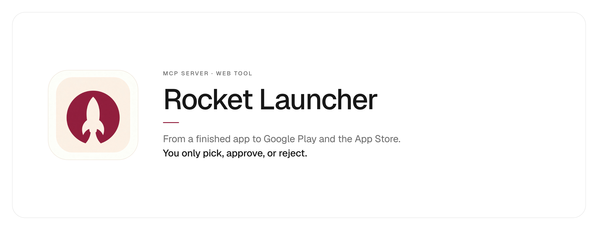
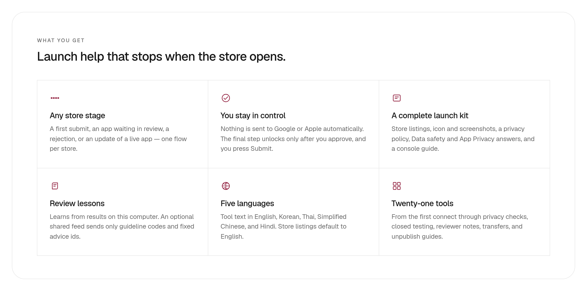
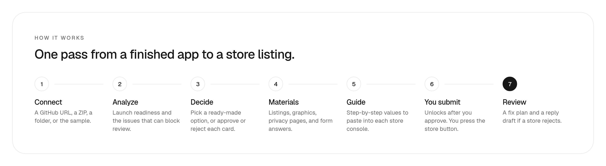

<p align="center">
  
</p>

# Rocket Launcher

A free **MCP server** and **web tool** that helps people who already built an Android or iOS app get it onto **Google Play** and the **App Store**.

You connect the app once. From then on you only **pick, approve, or reject**. Nothing is submitted to a store automatically. The final step of the guide unlocks only after you approve, and you press the store’s Submit button yourself.

[](https://github.com/JaeTaekOh/RocketLauncher)
[](https://modelcontextprotocol.io)
[](LICENSE)
[](#languages)

**Website:** [jaetaekoh.github.io/RocketLauncher](https://jaetaekoh.github.io/RocketLauncher/) · **Web app:** [Open the web version](https://jaetaekoh.github.io/RocketLauncher/app/)

- [Who it is for](#who-it-is-for)
- [The one rule](#the-one-rule)
- [Any store stage](#any-store-stage)
- [What you get](#what-you-get)
- [How it works](#how-it-works)
- [Tools](#tools)
- [Install](#install)
- [Languages](#languages)
- [Privacy and shared review lessons](#privacy-and-shared-review-lessons)
- [Web app](#web-app)
- [Configuration](#configuration)
- [FAQ](#faq)
- [License](#license)

## Who it is for

People who have already built an Android app, an iOS app, or both — often with an AI assistant — and now need to get it through store review. It is also for an app that is already uploaded and waiting, was rejected, or is live and needs an update.

Talk to your assistant in plain language, for example:

> Help me launch my app with Rocket Launcher: https://github.com/me/my-app

> Use Rocket Launcher with the sample app.

> Apple rejected my app. I am pasting the message. Help me with Rocket Launcher.

## The one rule

**You only pick, approve, or reject. Rocket Launcher never submits, replies to a store, or deletes an app.**

- Choices are shown with ready-made options and a recommendation. You decide.
- `rocketlauncher_approve_submission` only records your yes. It does not talk to Google or Apple.
- A reply to a reviewer is a draft. You send it.
- Unpublish and delete steps are a guide only.

## Any store stage

The stage is the first, required choice for each store: **not submitted yet**, **in review**, **rejected**, or **live** (an update). Hints in the project (store links, fastlane metadata, version numbers) may suggest a stage. They never force a first launch.

- **In review.** There is nothing to submit and no new app record. Replacing the build can withdraw or delay the review, so a new build is offered only if you choose it. You get help to wait, a reply draft for “Information Needed” (you send it), and metadata-only fixes.
- **Rejected.** Paste the store’s message first (`rocketlauncher_report_review`). You get a fix plan, a reply draft, and a resubmit guide, using built-in checks plus lessons learned on this computer (and, when a lessons API is configured, lessons from other reviews).
- **Live.** This is an update: no closed test. The live listing (name, descriptions, category, languages, graphics, privacy URL) can be kept, and the guide covers the new version and “What’s new.” Technical checks still run.

## What you get

<p align="center">
  
</p>

The launch kit can include store listing text, a privacy policy and account-deletion page, Data safety / App Privacy / IARC answers, PrivacyInfo.xcprivacy, a code-fix diff for the fixes you approved, a 512×512 icon, a 1024×500 feature graphic, and 1080×1920 screenshots.

## How it works

<p align="center">
  
</p>

1. **Connect** the app (a public GitHub URL, a ZIP, a local folder, or the built-in sample).
2. **Analyze** launch readiness and the issues that can block review.
3. **Decide** on each card: pick an option, or approve or reject.
4. **Materials** — listings, graphics, privacy pages, and form answers — are generated after the decisions.
5. **Guide** walks you through Play Console or App Store Connect, with the value to paste at each step.
6. **You submit.** The last step unlocks after you approve. You press the button in the console.
7. **Review.** If a store rejects the app, paste the message to get a fix plan and a reply draft.

## Tools

The server exposes **21 tools**. Names always start with `rocketlauncher_`.

### Connect and decide

| Tool | What it does |
| --- | --- |
| `rocketlauncher_connect_app` | Connect an app once (public GitHub URL, local folder or ZIP, or the built-in sample) and analyze it for store-review problems. |
| `rocketlauncher_get_report` | Show launch readiness and every issue that can block review, in plain language. |
| `rocketlauncher_get_decisions` | List the choices you need to make, each with ready-made options and a recommendation. |
| `rocketlauncher_decide` | Record what you actually picked or approved. |
| `rocketlauncher_status` | Show the current step, the next action, and review lessons learned on this computer. |

### Check before you submit

| Tool | What it does |
| --- | --- |
| `rocketlauncher_check_requirements` | Check current Play and App Store technical requirements and deadlines, each with its official source. |
| `rocketlauncher_privacy_check` | Cross-check Data safety, App Privacy, PrivacyInfo.xcprivacy, permission texts, and the privacy policy, and draft what is missing. |
| `rocketlauncher_play_policy_audit` | Run a quick Google Play policy scan with Google’s Play Policy Insights rules, and point to the offline full audit. |
| `rocketlauncher_account_deletion_check` | Check in-app and web account-deletion paths when the app has sign-up or login. |
| `rocketlauncher_version_sync` | Check version and build numbers across Android, iOS, and related apps, including force-update safety. |
| `rocketlauncher_country_check` | Show Korea, EU, and Thailand rules that apply to the app, with official sources. Legal summaries only, not legal advice. |
| `rocketlauncher_closed_test` | Track Google Play’s 12 testers × 14 days closed-test rule, invitations, and the tester page. |
| `rocketlauncher_reviewer_notes` | Draft App Review notes and Play app-access notes, with placeholders only — never real passwords. |

### Make store materials

| Tool | What it does |
| --- | --- |
| `rocketlauncher_preview_graphics` | Show icon, feature-graphic, and screenshot options so you can pick. |
| `rocketlauncher_generate_store_materials` | Build the full launch kit: listings, privacy pages, form answers, graphics, and a ZIP. |

### Submit — you press the button

| Tool | What it does |
| --- | --- |
| `rocketlauncher_submission_guide` | Walk through Play Console or App Store Connect step by step, with the value for every field. The final step stays locked until you approve. |
| `rocketlauncher_approve_submission` | Record your explicit approval. This does not submit anything; you press Submit in the store console. |

### After review

| Tool | What it does |
| --- | --- |
| `rocketlauncher_report_review` | Record submitted, rejected (paste the store’s message), resubmitted, or approved. Returns a fix plan and a reply draft when needed. |
| `rocketlauncher_forget_lesson` | Remove one review lesson learned on this computer, only when you ask. |

### Move or remove an app

| Tool | What it does |
| --- | --- |
| `rocketlauncher_move_app_plan` | Plan moving an app to another developer account. Transfer and new registration are shown side by side; neither is the default. AdMob is an optional follow-up, not a required step. |
| `rocketlauncher_remove_app_guide` | Step-by-step guide to unpublish or delete an app on each store. Guide only; nothing is removed. |

There is also a prompt, `launch_my_app`, that starts this flow.

## Install

> [!NOTE]
> The npm package [`rocket-launcher-mcp`](https://www.npmjs.com/package/rocket-launcher-mcp) is **not published yet** (coming soon). Do not run `npx -y rocket-launcher-mcp` until it is. Until then, run the server from a clone of this repository.

**Requirements:** [Node.js](https://nodejs.org/) 20 or later, and an MCP client such as Claude Desktop, Claude Code, Cursor, or Gemini CLI.

```bash
git clone https://github.com/JaeTaekOh/RocketLauncher.git
cd RocketLauncher/mcp
npm install
```

Then point your client at the server file. Replace `/ABS/PATH/TO/RocketLauncher` with the real path of your clone.

**Standard config** (works in most MCP clients):

```json
{
  "mcpServers": {
    "rocket-launcher": {
      "command": "node",
      "args": ["/ABS/PATH/TO/RocketLauncher/mcp/server.mjs"]
    }
  }
}
```

<details>
<summary>Claude Desktop</summary>

Settings → Developer → **Edit Config** opens `claude_desktop_config.json`. Add the standard config above, then fully quit and reopen the app.

- macOS: `~/Library/Application Support/Claude/claude_desktop_config.json`
- Windows: `%APPDATA%\Claude\claude_desktop_config.json`

Source: [Connect to local MCP servers](https://modelcontextprotocol.io/docs/develop/connect-local-servers).

</details>

<details>
<summary>Cursor</summary>

Put the standard config in the project’s `.cursor/mcp.json`, or in `~/.cursor/mcp.json` for every project. Cursor will ask you to approve the server the first time.

With the Cursor CLI, `mcp list-tools rocket-launcher` should list the tools after the server is enabled.

</details>

<details>
<summary>Gemini CLI</summary>

Put the standard config in `~/.gemini/settings.json` (all projects) or `.gemini/settings.json` (one project). Restart Gemini CLI and run `/mcp` to see the tools.

Source: [Gemini CLI MCP servers](https://geminicli.com/docs/tools/mcp-server/).

</details>

<details>
<summary>Claude Code</summary>

```bash
claude mcp add rocket-launcher -- node /ABS/PATH/TO/RocketLauncher/mcp/server.mjs
claude mcp list
```

You can also load the local plugin after `bash tools/build_plugin.sh`:

```bash
claude --plugin-dir plugin-package/rocketlauncher
```

</details>

<details>
<summary>When the npm package is published</summary>

The intended command will be `npx -y rocket-launcher-mcp` (stdio). Example:

```json
{
  "mcpServers": {
    "rocket-launcher": {
      "command": "npx",
      "args": ["-y", "rocket-launcher-mcp"]
    }
  }
}
```

That command does not work today. This section is here so the switch is obvious later.

</details>

From a checkout you can also run:

```bash
cd mcp && npm start          # stdio
npm run http                 # http://127.0.0.1:5181/mcp
npm test                     # automated tests
```

More client notes, HTTP mode, and environment variables are in [PLUGIN.md](PLUGIN.md).

## Languages

Tool text comes in five languages, selected with the optional `lang` argument:

| Code | Language |
| --- | --- |
| `en` | English (default if `lang` is omitted) |
| `ko` | Korean |
| `th` | Thai |
| `zh` | Simplified Chinese |
| `hi` | Hindi |

Store listings for your app default to English. Korean, Thai, Simplified Chinese, or Hindi listings can be added if you pick them.

This README is in English. The web app also opens in English; use the globe button in the header to change language in the browser.

## Privacy and shared review lessons

- App files are read only on the computer running the client (or in the browser, for the web app). Public GitHub repositories are read through the GitHub public API. There are no accounts, no API keys, and no telemetry.
- Progress for the MCP server is saved in `~/.rocketlauncher` (override with `ROCKETLAUNCHER_HOME`). The web app saves progress in this browser’s `localStorage`.
- When you report a store review result, a generalized lesson is stored on this computer in `~/.rocketlauncher/lessons.json`. It does not keep the original store message, app names, or emails.
- **Shared lessons (optional).** When a lessons API is configured, a real (non-demo) learned result may send one anonymized record: `store`, `codes` (guideline / ITMS / Play policy codes), `advice_id` (a key from Rocket Launcher’s fixed table), and `event`. **Never sent:** the store’s message, app name, bundle or package id, project id, paths, emails, or any other free text. The built-in demo never sends. Combined counts may be shown as “From other reviews” reminders; they never become must-fix items.
- The default API URL is `https://rocket-launcher-lessons.prezentree.workers.dev/api/lessons` (`lessonsApiUrl` in `js/config.js`). Set `ROCKETLAUNCHER_LESSONS_API` to an empty value to keep lessons only on this computer — an empty value wins over the default. If the variable is omitted, the default URL is used. If the API is empty or unreachable, everything still works locally.

See [privacy.html](privacy.html) and [plugin-src/PRIVACY.md](plugin-src/PRIVACY.md).

`vendor/play-policy-insights/` is Google’s Play Policy Insights skill from [android/skills](https://github.com/android/skills) (Apache License 2.0), included unmodified with its license and a `NOTICE`.

## Web app

The web app is at **[https://jaetaekoh.github.io/RocketLauncher/app/](https://jaetaekoh.github.io/RocketLauncher/app/)**. How-to-connect instructions are on the [homepage](https://jaetaekoh.github.io/RocketLauncher/).

You can also run it locally from this repository:

```bash
# from the repository root — Node.js 18 or later
npm start
# open http://127.0.0.1:5180/
```

Change the port with `PORT=8080 npm start`. Opening `index.html` directly (`file://`) works for the built-in sample and for ZIP or folder connections. Public GitHub connections call the GitHub API from the browser and, on the local preview server only, fall back to `/gh` if blocked.

## Configuration

| Name | Default | Meaning |
| --- | --- | --- |
| `ROCKETLAUNCHER_HOME` | `~/.rocketlauncher` | Folder for progress and generated materials |
| `ROCKETLAUNCHER_ALLOW_PATH` | on for stdio / off for HTTP | Allow connecting local folders and ZIPs |
| `ROCKETLAUNCHER_ALLOWED_ORIGINS` | none | Origins allowed in HTTP mode (comma-separated) |
| `ROCKETLAUNCHER_ALLOWED_HOSTS` | localhost port | Hosts allowed in HTTP mode |
| `ROCKETLAUNCHER_LESSONS_API` | `lessonsApiUrl` in `js/config.js` | Shared review-lessons API base URL. An empty value disables sharing; omit the variable to use the default. |

`js/config.js` also has `feedbackUrl` (GitHub Issues).

Graphics in the MCP server need the optional `@napi-rs/canvas` package (`npm install` in `mcp/`). Without it, everything else still works.

## FAQ

**Does this submit my app to Google Play or the App Store?**  
No. You approve, then you press Submit in the store console.

**Do I need API keys, tokens, or store passwords?**  
No. Never put passwords or keys into chat. Reviewer-account fields stay as placeholders; you type them only in the console.

**Can I install it with `npx` today?**  
Not yet. The npm package is coming soon. Use a clone, as in [Install](#install).

**My app is already in review, rejected, or live. Can I still use this?**  
Yes. Stage is a required choice per store. See [Any store stage](#any-store-stage).

**What if I do not want shared review lessons?**  
Set `ROCKETLAUNCHER_LESSONS_API` to an empty value (for example `ROCKETLAUNCHER_LESSONS_API=` in the environment). That disables the shared feed even if `js/config.js` has a default URL. Local lessons and the rest of the flow keep working. You can also remove one local lesson with `rocketlauncher_forget_lesson`.

**Where do I ask a question or report a problem?**  
[GitHub Issues](https://github.com/JaeTaekOh/RocketLauncher/issues).

## License

[MIT](LICENSE). © Prezentree.
